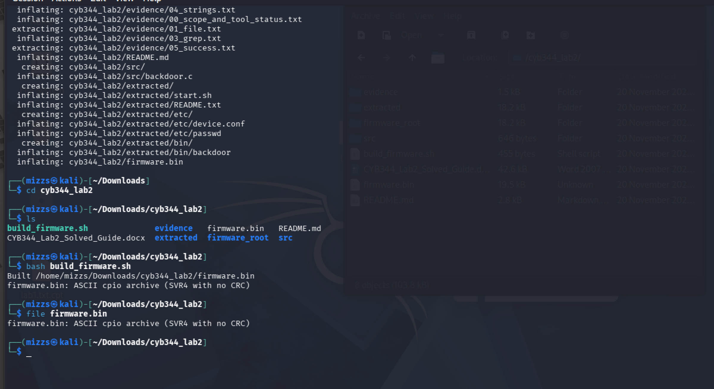
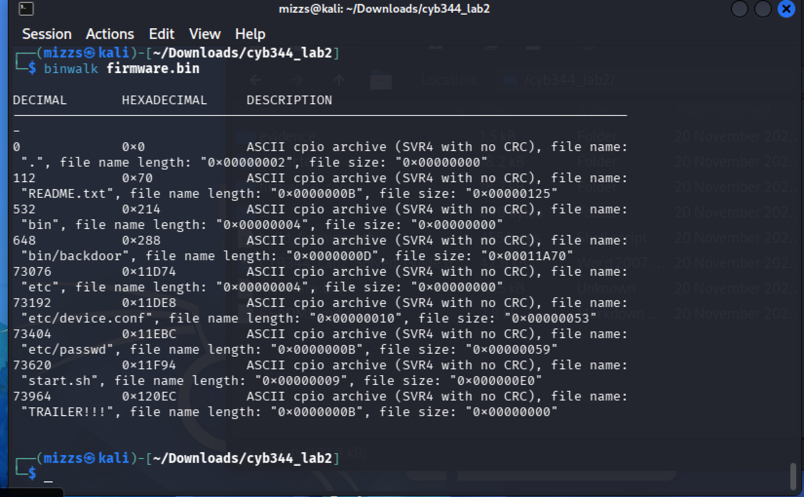
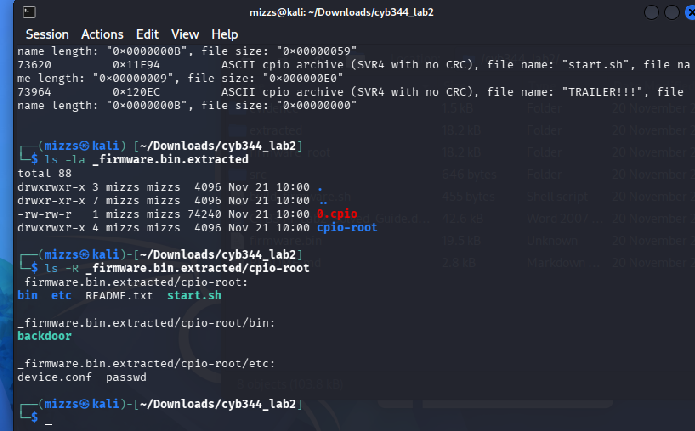
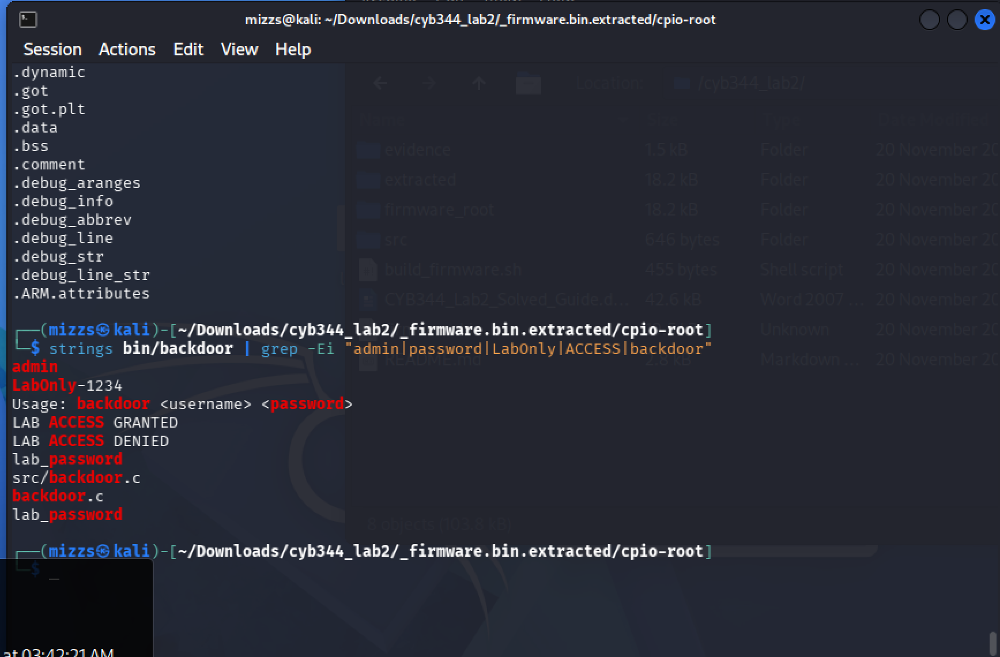
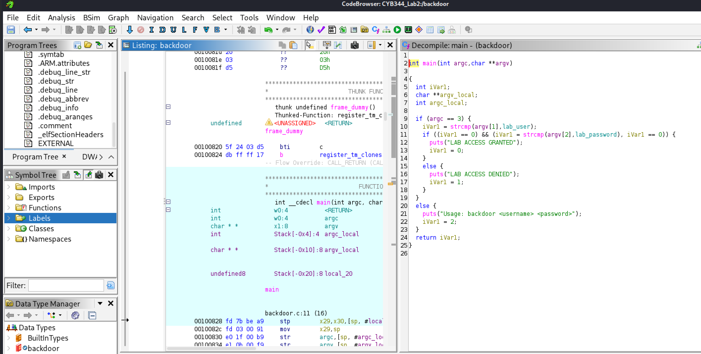

# Firmware Security Analysis

## Overview

A practical firmware security lab focused on firmware extraction, static binary analysis, and reverse engineering.

The objective is to identify security weaknesses within embedded firmware and understand binary behavior without executing the target program.

## Tools & Technologies

- Linux
- Binwalk
- Ghidra
- Strings
- Grep
- ELF Binary Analysis

## Analysis Workflow

1. Identify the firmware file format.
2. Extract the firmware contents.
3. Examine configuration files.
4. Identify suspicious strings and hardcoded credentials.
5. Analyze binary functions and authentication logic.
6. Document security findings.

## Key Findings

- Identified a CPIO firmware archive.
- Discovered hardcoded credentials within the test firmware.
- Identified a Linux ELF binary.
- Examined authentication logic and `strcmp()` comparisons.
- Identified access-granted and access-denied execution paths.

## Technical Write-up

The complete technical analysis, including command outputs, 
security findings, reverse engineering results, and security 
recommendations, is available below.

[View Full Firmware Security Analysis](analysis/firmware-analysis.md)

## Analysis Preview

### Firmware Identification

Identifying the firmware file type and structure.

### Binwalk Analysis

Examining the firmware image and identifying embedded components.

### Firmware Extraction

Extracting and inspecting the firmware contents.

### Static Binary Analysis

Inspecting readable strings and embedded information within 
the extracted binary.

### Reverse Engineering with Ghidra

Examining decompiled code, function behavior, and 
authentication logic.

## Repository Structure

    Firmware-Security-Analysis/
    ├── README.md
    ├── analysis/
    │   └── firmware-analysis.md
    └── screenshots/
        ├── firmware-identification.png
        ├── binwalk-scan.png
        ├── firmware-extraction.png
        ├── strings-analysis.png
        └── ghidra-decompiler.png

## Learning Outcomes

- Firmware extraction and inspection
- Static binary analysis
- Reverse engineering fundamentals
- Hardcoded credential detection
- Authentication logic analysis

## Disclaimer

This project was conducted in a controlled environment 
for cybersecurity research and educational purposes.
The firmware is a simulated sample.
