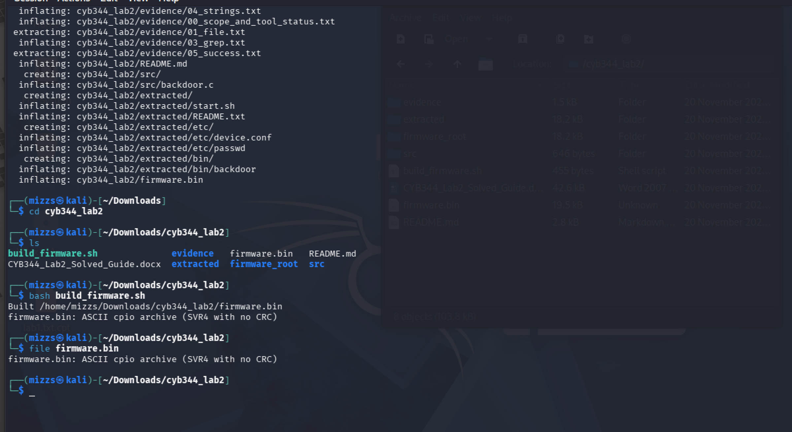
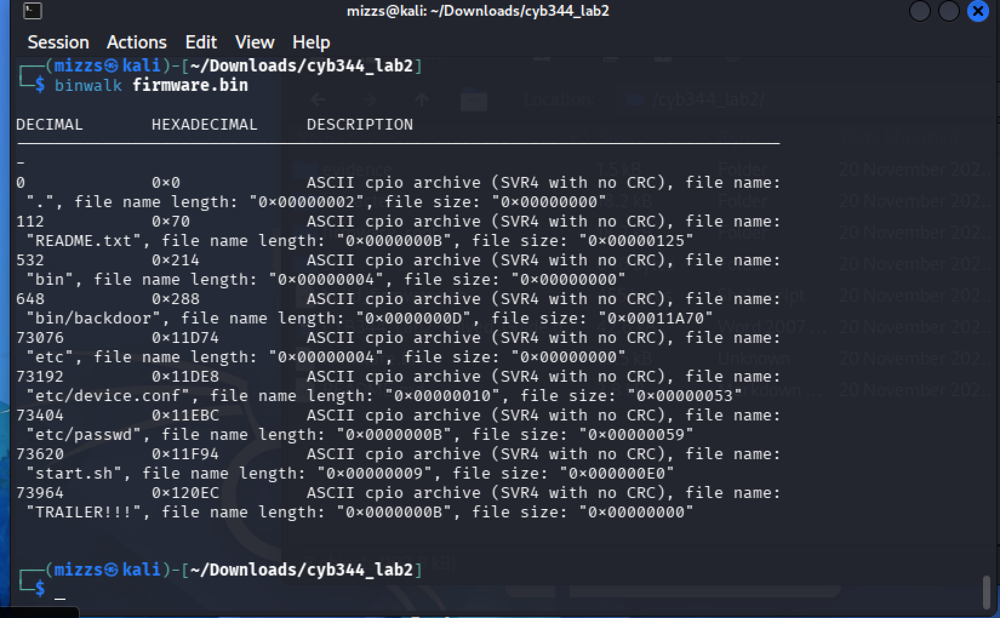
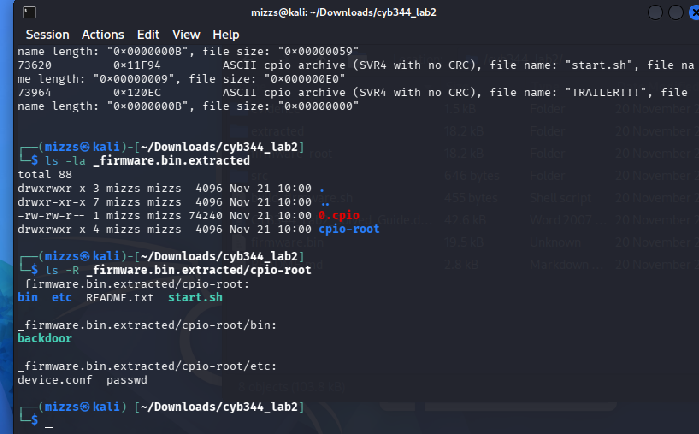
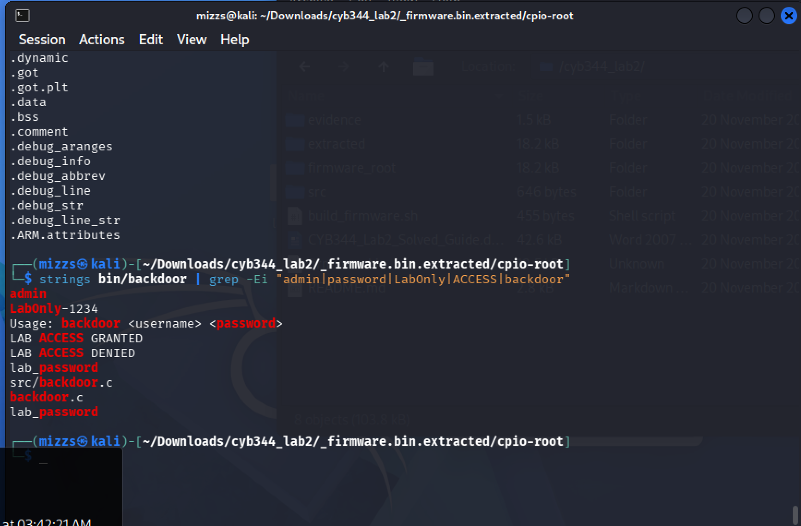
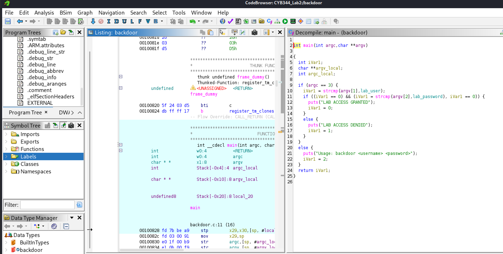

# Firmware Security Analysis — Technical Write-up

## Overview

I analyzed a deliberately vulnerable firmware sample in a controlled Linux environment to understand how embedded credentials can be exposed through static analysis. I examined the firmware archive, extracted its filesystem, searched for sensitive strings, and used Ghidra to investigate the authentication logic without executing the target binary.

## 1. Firmware identification

```bash
file firmware.bin
```

Observed output:

```text
firmware.bin: ASCII cpio archive (SVR4 with no CRC)
```

The sample is a CPIO archive containing a filesystem rather than an opaque firmware image. This identifies the archive format but does not, by itself, establish a security vulnerability.



## 2. Firmware scanning and extraction

```bash
binwalk firmware.bin
binwalk -e firmware.bin
```

Binwalk identified an ASCII CPIO archive beginning at offset `0x0`. Extraction produced `0.cpio` and a `cpio-root` directory. The recovered filesystem contained:

```text
cpio-root/
├── README.txt
├── bin/
│   └── backdoor
├── etc/
│   ├── device.conf
│   └── passwd
└── start.sh
```

| File | Purpose in the sample |
| --- | --- |
| `bin/backdoor` | Authentication executable using fixed test credentials |
| `etc/device.conf` | Device configuration containing administrator credentials |
| `etc/passwd` | Linux user account information |
| `start.sh` | Simulated startup script |
| `README.txt` | Description of the sample |





## 3. Filesystem inspection

From the extracted filesystem, I searched for authentication-related strings and potentially suspicious commands:

```bash
grep -Rin 'wget\|admin\|password\|root' .
```

The recorded results identified:

- A plaintext administrator username and test password in `etc/device.conf`.
- Authentication-related content inside `bin/backdoor`.
- A root account entry in `etc/passwd`.
- A commented-out `wget` command in `start.sh` referencing a reserved `.invalid` domain.

The hardcoded credentials were the primary security finding. The root account entry is not inherently malicious. The download command was a comment, not an executed instruction, and no network download was demonstrated.

## 4. Static binary analysis

```bash
strings bin/backdoor
```

The binary exposed the test credentials, `lab_password`, and authentication-related messages:

```text
admin
LabOnly-1234
Usage: backdoor <username> <password>
LAB ACCESS GRANTED
LAB ACCESS DENIED
lab_password
```

These are deliberately embedded demonstration credentials, not production credentials. Their visibility illustrates how secrets stored in compiled programs can be recovered without access to the source code.



## 5. Reverse engineering with Ghidra

I inspected the decompiled `main()` function in Ghidra. The code contained two `strcmp()` comparisons for checking the supplied username and password against fixed credentials. The authentication logic displays `LAB ACCESS GRANTED` if both comparisons succeed, and `LAB ACCESS DENIED` otherwise. A usage message is displayed when the expected arguments are not provided.

This corroborated the strings analysis: the embedded credentials were used by the authentication logic, not simply present as unrelated text. The finding is based on static inspection; no runtime exploitation was necessary.



## 6. Security findings and recommendations

| Finding | Security implication | Recommended mitigation |
| --- | --- | --- |
| Plaintext credentials in device configuration | Credentials can be recovered from extracted firmware | Avoid distributing reusable secrets in firmware; provision credentials securely |
| Hardcoded credentials in authentication binary | Fixed credentials can be recovered through static analysis | Remove embedded passwords and use secure authentication with properly salted password hashes where applicable |
| Commented download command | Suspicious-looking string, but no active download behavior was observed | Review startup scripts and remove unnecessary references |

The credential weaknesses could allow unauthorized access if comparable code were deployed on a real device. This sample does not establish that any real device was affected.

## Conclusion

This analysis demonstrated the value of combining archive inspection, string extraction, and decompilation. Binwalk exposed the filesystem, text searches highlighted sensitive content, and Ghidra confirmed how the authentication mechanism used hardcoded credentials.

The project uses a deliberately vulnerable sample in a controlled environment for security learning and research.
